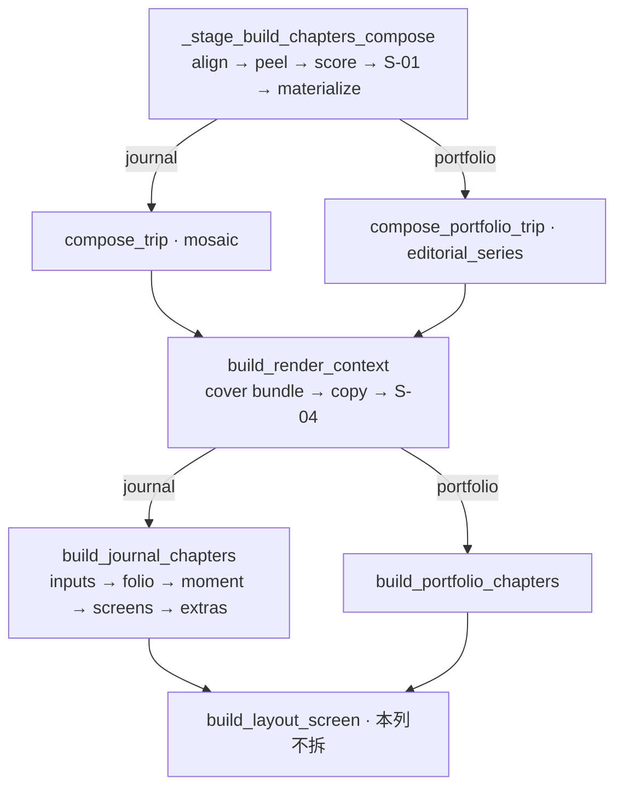

# 可读主链（RCL）

短地图。合同以 [PRD-READABLE-CORE-LINE-V1.md](./PRD-READABLE-CORE-LINE-V1.md) **v0.2.0** 为准。所有权仍看 [dual-pipeline-ownership.md](./dual-pipeline-ownership.md)。

> 让 `curate → compose → assemble → chapters` **不查票号也能读懂在干什么**。拆的是编排核，不是算法壳。

## 改主链前先跑

```powershell
python scripts/lint_dual_pipeline_ownership.py --explain <file>
python scripts/lint_rcl_orchestrators.py
python scripts/lint_frontend_live_path.py
python -m pytest -m pipeline_isolation -q
```

新阶段模块（W1 才建）同样先 `--explain`，不得出现身份 `if`。

| 门 | 状态 |
|----|------|
| 所有权 lint | 现网已有 |
| 三核行数棘轮 / 活路径闭包 | RCL W0 · **已落**（`lint_rcl_orchestrators.py` / `lint_frontend_live_path.py`） |
| 形状 + `render_fingerprint` | 每个里程碑必绿 |

**G-RCL-01**：下一支改 `assemble.py` / `journal_chapters.py` / `_stage_build_chapters_compose` 的**功能** PR，合并前 RCL W0 必须在主干。

## 主链（不要改顺序）



身份 `if` **只准** S-01（`curate.py`）与 S-04（`assemble.py`）。阶段函数零身份。

## 三个编排核（RCL L1 唯一拆点）

| 核 | 现值（AST） | W1 上限 | 目标阶段（不可乱序） |
|----|-------------|---------|----------------------|
| `build_render_context` | 141 | ≤160 | 表面 → 封面 → 文案护栏 → **S-04** → extras → 组装返回 |
| `build_journal_chapters` | 51 | ≤140 | 输入 → folio → 高光/长图 → 屏循环 → extras |
| `_stage_build_chapters_compose` | 99 | ≤160 | 对齐桶 → 剥异常 → 打分 → **S-01** → 物化 |

`build_portfolio_chapters` 已短，**不拆**。

W1 预注册模块（**不建空壳**，与第一批调用同提交）：`compose_stages.py` · `assemble_cover.py` · `assemble_copy.py` · `journal_folio.py` · `journal_screens.py` · `types/trip_hot.py`。

## 注释（随手，不专项）

第一句写意图，票号放句尾。编排核用 5～8 行阶段大纲，不要半页 PRD 摘录。旧横幅跟随搬家，不批量改写。

## 列车（L0–L2 = RCL · L3–L7 未立项）

一年最多再开一列。L3 起必须**单独 PRD + 七席**，禁止从 RCL 偷运。

| 列 | 主题 | 状态 | 买什么 | 明确不做 | 立项代号（预留） |
|----|------|------|--------|----------|------------------|
| **L0** | 地图与谎言 | RCL W0 · **已落** | 本文 + `TECH-ARCHITECTURE.md` 现状 + 活路径清单 + 三核棘轮 | 搬家函数 | — |
| **L1** | 拆三个编排核 | RCL W1 · **assemble / journal / curate 已拆** | 主链一屏能读完调用顺序 | 不拆 planner / `longshot.js` | — |
| **L2** | 热路径类型 | RCL W2 | `studio` / `titleArt`(runtime) / `chapters` / `slots` | 不改 `trip.schema.json` · 不 typed 全集 | — |
| **L2b** | 活路径可见 | RCL W3 | 文件头 `LIVE/READER/FROZEN` + CSS 目录（marker 外） | 不拆第三份 CSS | — |
| **L3** | `curate.py` 减厚 | **未立项** | 预检 / 分桶 / 构图 / 收尾四文件；别名墙沉底；god-module **只降** | 不复制成两条 curate；S-01 留在 `curate.py` | `PRD-CURATE-STAGE-SPLIT` |
| **L4** | 渲染上下文 | **未立项** | `context.py` 按产物切（card / row / scroll / layout-screen） | 不拆算法；不新造模板类型层 | `PRD-RENDER-CONTEXT-SPLIT` |
| **L5** | 导出面板 JS | **未立项** | 先闭包证明再拆 `preview-toolbar/longshot.js` | 不删 `v3`（现行活路径）；不合并读者面 `visual-journal/longshot.js` | `PRD-PREVIEW-LONGSHOT-SPLIT` |
| **L6** | Studio 导出门面 | **未立项** | `handle_longshot` 等按「解析 → dispatch → 进度」切 | 不改导出产品行为 | `PRD-EXPORT-HANDLER-SPLIT` |
| **L7** | 算法核叙事 | **默认不做** | 最多改文件头指向现行 LTE/DPI | 无产品级版式 bug 则不开工 | — |

**G-STD-01**（L3 立项时写入）：`curate.py` 再增长必须 `--allow-growth` 并说明「为什么不先抽 stage」。未立项前只是预告，不是门。

### L3 开工前提

- RCL W1 已合入（构图阶段已离开 616 行函数）。
- `csc-w2b-god-module-ratchet-baseline.json` 已随 W1 下调。
- 单独七席；本页表格升「进行中」并链新 PRD。

### 明确拒绝（各列通用）

全仓库补 docstring · 清全部票号 · 全量 TypeScript · `trip` 改 dataclass · 第三份 CSS · 全局函数 ≤80 行门 · 重写 mosaic / `screen_planner` 算法。

## 已知债（明示挂起）

| 债 | 约行数 | 挂在 |
|----|--------|------|
| `screen_planner.py` | 2016 | L7 / 仅文件头 |
| `build_layout_screen` | 355 | L4 |
| `load_config` | 515 | 不在本列车 |
| `handle_longshot` | 417 | L6 |
| `preview-toolbar/longshot.js` | ~132 KB | L5 |
| `curate.py` 兼容别名墙 | — | L3 |
| `meta.titleArt` 不在 schema | — | CAL 数据模型债 · RCL 标 runtime |

活路径清单（W0）：[frontend-live-path.md](./frontend-live-path.md)（闭包根写死 `templates/studio/preview-toolbar.js` + `homepage-v2/bootstrap.js`）。
