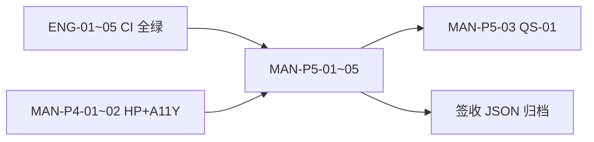

# Travelogue 任务清单（人工验收 + 编码遗留）

| 属性 | 内容 |
|------|------|
| **日期** | 2026-06-01 |
| **用途** | 发布准备分工：区分「必须人做」与「必须写代码/修测试」 |
| **权威闸门** | [ACCEPTANCE.md](../ACCEPTANCE.md) · 当前生产闸门 **Phase 5** |
| **记录目录** | [acceptance-records/](../acceptance-records/README.md) |

**图例**：`[ ]` 未开始 · `[~]` 进行中 · `[x]` 完成 · **P0** 阻断发布 · **P1** 重要 · **P2** 不阻塞发布

---

## 如何使用

1. **人工验收**：按 Phase 分组执行，结果写入对应 JSON / Markdown（见「记录文件」列）。
2. **编码任务**：可并行推进；**P0-ENG** 项建议先于或同步 P5 手验（避免手验被测试回归打断）。
3. **发布最小集**：完成表中所有 **P0-MAN** + **P0-ENG** 后，方可宣称 Phase 5 闸门通过。

---

# 一、人工验收任务（MAN）

## A. Phase 5 · 当前发布闸门（优先）

| ID | 优先级 | 任务 | 验收项 / 协议 | 记录文件 | 通过标准摘要 | 状态 |
|----|:------:|------|---------------|----------|--------------|:----:|
| MAN-P5-01 | **P0** | 零编辑主路径计时 | UX-P5-80-01 | [phase5-zero-edit.json](../acceptance-records/phase5-zero-edit.json) | 双击 bat → 长图 PNG reveal；≤15min；禁止 drawer/改字 | [ ] |
| MAN-P5-02 | **P0** | 零编辑子项签收 | AC-P5-A-01～03 · AC-P2-02 · AC-P4-02 | 同上 `checks` | 主 CTA 长图、Job 进度、微信可读、精选 chips | [ ] |
| MAN-P5-03 | **P0** | 排版冲刺 QS-01 | AC-P5-C-02 · M20-B-03 | [phase5-layout-sprint.json](../acceptance-records/phase5-layout-sprint.json) | 10 本真实相册 · 调优版 ≥8/10 胜出 | [ ] |
| MAN-P5-04 | **P0** | 卷轴定性访谈 | UX-P5-SCROLL-01 · M20-C-03 | [phase5-scroll-qualitative.json](../acceptance-records/phase5-scroll-qualitative.json) | 3–5 人 · ≥3/5「哇/高级」· 完成率 ≥70% | [ ] |
| MAN-P5-05 | **P0** | 卷轴 / 阅读态手测 | AC-P5-B-01/02 | 同上或 trip 笔记 | auto breath · share 无 toolbar | [ ] |
| MAN-P5-06 | **P1** | 长图与 toolbar 细节 | AC-P5-A-04～06 · AC-P5-UX-01/02 | phase5-zero-edit 或手测笔记 | 宽度 428+、toolbar 极简、409 人话 | [ ] |
| MAN-P5-07 | **P1** | 排版地基抽检 | AC-P5-C-01/03 | trip 手测 | 封面非大头 · 长图≤15屏 vs web 全量 | [ ] |
| MAN-P5-08 | **P1** | Tier1 卷轴仪式（不阻塞 A） | AC-P5-B-03～05 | linzhi 等 | 章分隔、epilogue、screenplay | [ ] |
| MAN-P5-09 | **P2** | 排版盲评 P-EVAL | P5-8.1（不阻塞 Tier0） | [phase5-peval.json](../acceptance-records/phase5-peval.json) | `phase5_blind_review.py` + 人工偏好 | [ ] |
| MAN-P5-10 | **P1** | 本地 web-view 手测 | P5-MP-2 | [phase5-webview-manual.json](../acceptance-records/phase5-webview-manual.json) | MP-WV-01～11（share、breath、性能） | [ ] |

**P5 发布必达（Tier 0）汇总**：MAN-P5-01～05 + **继承** MAN-P4-HP（见下）+ MAN-P4-A11Y-03。

---

## B. Phase 4 · 意图层（并入 P5 发布清单）

| ID | 优先级 | 任务 | 验收项 | 记录 / 命令 | 状态 |
|----|:------:|------|--------|-------------|:----:|
| MAN-P4-01 | **P0** | Studio 首页六态 | AC-P4-HP-01～06 | [ACCEPTANCE-PHASE4.md](../ACCEPTANCE-PHASE4.md) §3 | [ ] |
| MAN-P4-02 | **P0** | reduced-motion | AC-P4-A11Y-03 | 系统开「减少动画」走查 | [ ] |
| MAN-P4-03 | **P1** | 双文件夹成功页 | AC-P4-02 | 截图 + phase4 笔记 | [ ] |
| MAN-P4-04 | **P1** | user_tier 回归签字 | AC-P4-05 | `pytest tests/test_user_tier*.py -q` + 签字 | [ ] |
| MAN-P4-05 | **P2** | Peak 深链 e2e | AC-P4-03 | 手测 `#screen-` 首屏 | [ ] |
| MAN-P4-06 | **P2** | P-EVAL 意图盲评 | UX-P4-02 · G-P4-07 | [phase4-intent.json](../acceptance-records/phase4-intent.json) | 3 相册×2 变体 · ≥4/6 对 | [ ] |
| MAN-P4-07 | **P2** | 精选语义访谈 | UX-P4-01 | 5 人访谈记录 | [ ] |
| MAN-P4-08 | **P2** | 全跳过仍 ≤20min | UX-P4-03 | 计时记录 | [ ] |

---

## C. Phase 2 · Studio 基础（已并入 P5，建议抽样补签）

| ID | 优先级 | 任务 | 验收项 | 状态 |
|----|:------:|------|--------|:----:|
| MAN-P2-01 | **P1** | 非维护者全流程 | AC-P2-01a/b · AC-P2-02/03 | [ ] |
| MAN-P2-02 | **P1** | 长图稳定性 5 trip | LS-P2-01 | `phase2_longshot_stability.py` | [ ] |
| MAN-P2-03 | **P2** | 性能闸门计时 | PF-P2-01～03 · PF-P2-02c | [ ] |
| MAN-P2-04 | **P2** | Studio UX 清单 | UX-P2-01～06 | [ ] |

---

## D. Phase 6 · 稳定与艺术（开发准备，非 P5 阻断）

| ID | 优先级 | 任务 | 验收项 | 记录 | 状态 |
|----|:------:|------|--------|------|:----:|
| MAN-P6-01 | **P1** | 离线 benchmark 签收 | AC-P6-01～06 | [phase6-quality-eval.json](../acceptance-records/phase6-quality-eval.json) | [ ] |
| MAN-P6-02 | **P1** | 封面盲评 A/B | AC-P6-04 · TC-P6-03 | `phase6_cover_blind_review.py` | [ ] |
| MAN-P6-03 | **P1** | 回滚演练 | AC-P6-07 | rollout runbook 签字 | [ ] |
| MAN-P6-04 | **P2** | License BOM | AC-P6-08 | phase6-license-bom | [ ] |
| MAN-P6-05 | **P2** | 艺术 AC 五项 | ART-AC-01～05 | 叙事/节奏/封面/去同质/呼吸 | [ ] |
| MAN-P6-06 | **P2** | 业务指标 BR（需真实数据） | BR-P6-01～04 | 连续 7–14 天生产 telemetry | [ ] |
| MAN-P6-07 | **P1** | G3 全量稳定观察 | G3 `active_full` | [phase6-rollout-log.json](../acceptance-records/phase6-rollout-log.json) | [~] |

---

## E. Phase 7 · 性能 + RAW Gate

| ID | 优先级 | 任务 | 验收项 | 记录 | 状态 |
|----|:------:|------|--------|------|:----:|
| MAN-P7-01 | **P1** | 采集 P6 基线（同机） | AC-P7 对比前提 | [phase7-perf-eval.json](../acceptance-records/phase7-perf-eval.json) `baseline.p6` | [ ] |
| MAN-P7-02 | **P1** | P7 G0 预检 + L0/L1 AC | AC-P7-01～11 | phase7-perf-eval + rollout-log | [ ] |
| MAN-P7-03 | **P2** | P7 G1→G3 灰度值班 | §8 门禁 | phase7-rollout-log | [ ] |
| MAN-P7-04 | **P1** | RAW Gate 手测 | AC-RAW-01～05 | [ACCEPTANCE-PHASE7-RAW-GATE.md](../ACCEPTANCE-PHASE7-RAW-GATE.md) | [ ] |

---

## F. 真实 Trip 手测笔记

| ID | 优先级 | Trip | 文件 | 状态 |
|----|:------:|------|------|:----:|
| MAN-TRIP-01 | **P1** | linzhi | [linzhi.md](../acceptance-records/linzhi.md) | [ ] |
| MAN-TRIP-02 | **P2** | mao | [mao.md](../acceptance-records/mao.md) | [ ] |
| MAN-TRIP-03 | **P2** | maomi | [maomi.md](../acceptance-records/maomi.md) | [ ] |

---

## G. MVP 历史基线（不单独阻断发布，可选回归）

| ID | 任务 | 说明 | 状态 |
|----|------|------|:----:|
| MAN-MVP-01 | AC-01～07 真实旅行 3 次 | 见 [ACCEPTANCE.md](../ACCEPTANCE.md) 附录 A | [ ] |

---

# 二、编码 / 测试 / 工程任务（ENG）

## H. P0 · 工程阻断（建议本周）

| ID | 优先级 | 任务 | 来源 | 改动要点 | 状态 |
|----|:------:|------|------|----------|:----:|
| ENG-01 | **P0** | 修复 CURATE_TOO_FEW 测试回归 | [studio-ui-test-fix-plan-0601.md](./studio-ui-test-fix-plan-0601.md) §A | fixture 图改为 ≥1600×1200（方案 A1） | [x] |
| ENG-02 | **P0** | 更新 homepage JS 断言 | 同上 §B | `test_studio_homepage_m12.py` 一行 | [x] |
| ENG-03 | **P0** | Playwright 全量隔离 | 同上 §C1 | conftest 末段执行 + 线程锁 + browser pool 重置 | [x] |
| ENG-04 | **P0** | importSource 断言对齐 | 同上 §D | `preserve_material_import_source_on_dedupe` | [x] |
| ENG-05 | **P0** | CI 全绿验证 | NR-P2-01 | `pytest` 全量 0 失败 | [x] |

---

## I. Phase 7 · 代码收尾

| ID | 优先级 | 任务 | 实施项 | 模块 | 状态 |
|----|:------:|------|--------|------|:----:|
| ENG-P7-01 | **P1** | P6 基线写入 perf-eval | M27-C-06 ◑ | `phase7_benchmark_run.py --write` | [x] |
| ENG-P7-02 | **P1** | 增量布局评分 | M29-A-03 ☐ | `layout_scoring.py` · `layout_search.py` | [x] |
| ENG-P7-03 | **P1** | layout golden 双跑 | M29-A-05 ◑ | `test_nr_p7_ci_fixture_layout_matches_*` | [x] |
| ENG-P7-04 | **P2** | M28 并行/预热收尾 | M28 ◑ | IMPLEMENTATION 已 ☑ | [x] |
| ENG-P7-05 | **P2** | ONNX Spike | M29-OPT-01～03 ☐ | `phase7-onnx-spike.md` + stub 脚本 | [x] |

---

## J. Studio P10 · 代码补项（PRD 后续）

| ID | 优先级 | 任务 | 来源 | 状态 |
|----|:------:|------|------|:----:|
| ENG-P10-01 | **P1** | resize 时导入文案刷新 | AC-P10-03 · `progress.js` 已有 | [x] |
| ENG-P10-02 | **P1** | Success/Failed/Loading Playwright | PRD-STUDIO-DUAL-LAYOUT | [x] |
| ENG-P10-03 | **P2** | Loading compact 形态 | `studio.css` compact loading | [x] |
| ENG-P10-04 | **P2** | experience-matrix 同步 | `experience-matrix.yaml` studio_surfaces | [x] |

---

## K. 体验样例 · 林芝（工作区未提交）

| ID | 优先级 | 任务 | 说明 | 状态 |
|----|:------:|------|------|:----:|
| ENG-EXP-01 | **P1** | 纳入版本控制 | `trips/linzhi/` 体验覆盖层（js/css/html） | `.gitignore` 例外 + README | [x] |
| ENG-EXP-02 | **P2** | 浏览器 E2E（可选） | AC-EXP-06/10/12 | 延后（人工验收后） | [-] |

---

## L. Phase 3/5/6 · 低优先级编码遗留

| ID | 优先级 | 任务 | 来源 | 状态 |
|----|:------:|------|------|:----:|
| ENG-P3-01 | **P2** | Recasa 只读对比 | M12-0-3 ☐ | `recasa_readonly_compare.py` | [x] |
| ENG-P3-02 | **P2** | 封面 sharpness+face | M12-2d ☐ | `_cover_face_bbox_multiplier` | [x] |
| ENG-P5-01 | **P1** | QS-01 脚本跑批填 JSON | `--scan-trips trips` 已跑 | [x] |
| ENG-P6-01 | **P2** | BR 真实 telemetry 接入 | BR-P6 fixture 替代 | 产品化后 | [-] |

---

# 三、发布最小路径（建议执行顺序）

| 周次 | 人工（MAN） | 编码（ENG） |
|------|-------------|-------------|
| **本周 P0** | MAN-P5-01～05 · MAN-P4-01～02 | ENG-01～05 |
| **本周 P1** | MAN-P5-06～07 · MAN-P5-10 | ENG-P5-01 · ENG-P10-01～02 |
| **下周** | MAN-P6-01～03 · MAN-P7-01～02 | ENG-P7-01～03 · ENG-EXP-01 |

---

# 四、统计摘要

| 类别 | P0 | P1 | P2 | 合计 |
|------|:--:|:--:|:--:|:----:|
| **人工验收 MAN** | 9 | 14 | 16 | **39** |
| **编码工程 ENG** | 5 | 9 | 9 | **23** |
| **发布最小集** | 14 项 | — | — | MAN×7 + ENG×5 + 继承 MAN-P4×2 |

---

## 变更记录

| 日期 | 说明 |
|------|------|
| 2026-06-01 | 初版：从 ACCEPTANCE / IMPLEMENTATION / acceptance-records / studio-ui-test-fix-plan 汇总 |
| 2026-06-01 | 编码收尾：P7-D2 增量评分 · 林芝 gitignore · QS-01 scan · ONNX/Recasa stub |
