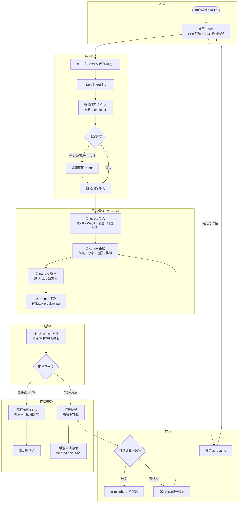
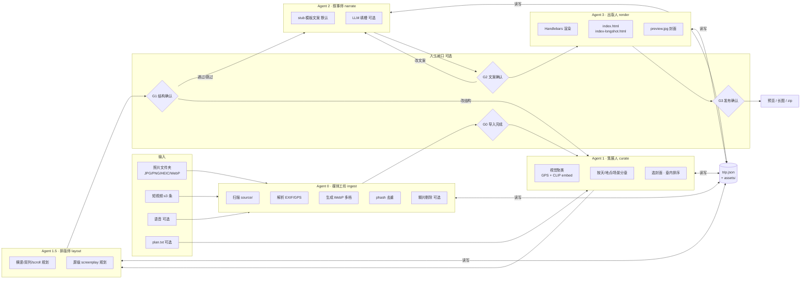
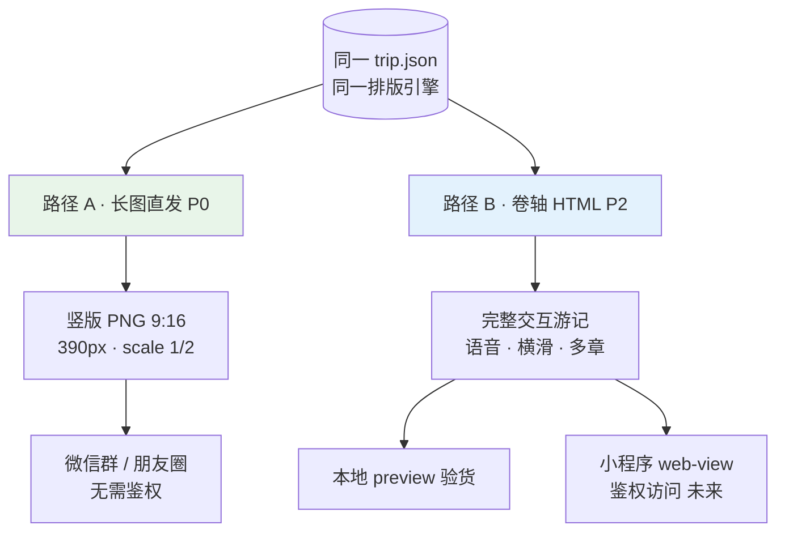
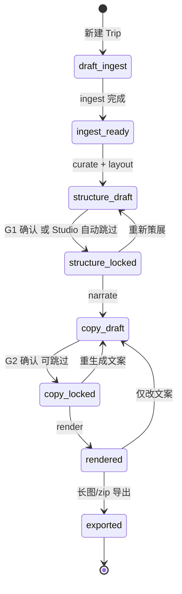
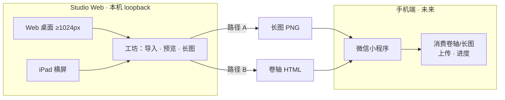

# Travelogue · 业务流程说明

| 属性 | 内容 |
|------|------|
| **产品代号** | Travelogue（游记智能体） |
| **文档类型** | 业务流程总览 |
| **状态** | 基于当前代码与 PRD 整理 |
| **关联文档** | [README.md](../README.md) · [AGENT-ARCHITECTURE.md](./AGENT-ARCHITECTURE.md) · [SHARING.md](./SHARING.md) · [PRD-STUDIO-HOMEPAGE-v2.md](./PRD-STUDIO-HOMEPAGE-v2.md) · [PRD-PHASE5.md](./PRD-PHASE5.md) |
| **更新日期** | 2026-06-04 |

---

## 1. 产品定位（一句话）

**照片文件夹 → 自动分章 · 排版 · 配文 → 双交付物（卷轴 HTML + 微信长图）**

---

## 2. 端到端用户主流程（Studio · 约 80% 用户）



---

## 3. 技术管线（Agent 架构 · 数据契约 `trip.json`）



### 3.1 Agent 与人类写作步骤映射

| 人类在做什么 | 对应 Agent | 产出物（写入 `trip.json`） |
|--------------|------------|---------------------------|
| 把相机/手机里的素材倒进电脑，转格式、听一遍语音 | **Agent 0 · 媒体工坊** | `assets[]` 元数据、展示用图/视频、ASR 草稿 |
| 翻相册：删糊片、按天/地点分堆、选封面和每章代表作 | **Agent 1 · 策展人 Curator** | `chapters[]` 骨架、`patternId`、章内选图顺序 |
| 拼图：横竖怎么摆、三联还是双列、全景宽条 | **Agent 1.5 · 排版师 Layout** | `chapters[].items[]`、`rowLayout`、`layout.slot` |
| 起标题、写一两句感受、给每张图配短图说 | **Agent 2 · 叙事师 Storyteller** | `meta.*`、章/卡片的 title·caption·lead |
| 检查渲染、导出给朋友看 | **Agent 3 · 出版人 Publisher** | `index.html`、资源完整性、预览图/zip |

### 3.2 三条铁律

1. **先结构后文案**：用户确认章节与选图（G1）之后，叙事师才动笔。
2. **各 Agent 不越权**：策展不改长文；排版不改文案、不写 HTML；叙事不改章序与块结构；出版不重写故事。
3. **可复现**：同一 `trip.json` + 同一模板版本 → 渲染结果一致。

---

## 4. 分享双轨（SHARING.md）



| 维度 | 路径 A · 长图 | 路径 B · 卷轴 |
|------|---------------|---------------|
| 交付物 | `{title}-longshot.png` | `index.html` + assets |
| 场景 | 群聊快享 · 30 秒扫完 | 沉浸阅读 · 5 分钟 |
| 技术 | Playwright 服务端截图 | Handlebars + breath/Lenis |
| 屏数 | 精选浓缩 ≤10–15 屏 | 完整叙事 |
| 隐私假设 | 用户接受照片出现在群内；不走身份验证 | 敏感；访问需身份验证（未来小程序） |

### 4.1 路径 A · 长图（P0 · Phase 2 主路径）

- **主入口**：Studio「保存长图」或 `travelogue export-longshot`
- **技术**：Playwright 加载 `index-longshot.html` → PNG 文件
- **分段**：输出高度 ≤5000px → 单 PNG；>5000px 或单章 >60 media-card → 按章分段
- **默认 scale**：CLI `1`；Studio UI `2`（推荐）

### 4.2 路径 B · 卷轴 HTML（P2 方向）

- **交付物**：完整交互游记（语音、横滑、多章）
- **消费端**：本地 preview 验货；未来小程序 web-view 鉴权访问
- **动效**：breath / Lenis / screenplay

---

## 5. Trip 状态机（编排器）

状态持久化在 `trip.json` 的 `pipeline.status`。



| 状态 | 含义 | 允许运行的 Agent |
|------|------|------------------|
| `draft_ingest` | 等待或正在导入 | 0 |
| `ingest_ready` | 素材就绪，未分章 | 1 |
| `structure_draft` | 已有章提案，待用户认 | 1（增量）、UI 编辑 |
| `structure_locked` | 结构已锁定 | 2 |
| `copy_draft` | 文案已生成，待用户认 | 2（单字段重生成）、UI 编辑 |
| `copy_locked` | 文案锁定 | 3 |
| `rendered` | 已有 HTML 预览 | 3（轻量重渲染）、UI 编辑 |
| `exported` | 已导出 zip | 3（再导出） |

### 5.1 重跑策略

| 用户操作 | 重跑范围 |
|----------|----------|
| 改 title/caption/hook | 仅 Agent 3（或跳过，若仅 JSON 未变可缓存） |
| 换语气、重生文案 | Agent 2 → Agent 3 |
| 调章序、删图、换封面 | Agent 1 → 1.5 → 若已锁定文案则提示重跑 Agent 2 |
| 仅改 `exportLayout` / 重新排版 | Agent 1.5 → 3 |
| 新一批上传（结构已锁定） | Agent 0 增量 → 提示是否合并进某章 → 可选 Agent 1 增量 |
| 补语音 | Agent 0 ASR → Agent 2 单卡 caption → Agent 3 |

---

## 6. 平台分工



| 端 | 范围 | 负责能力 |
|----|------|----------|
| **Web 桌面**（≥1024px） | Studio `/` | Bento · Import Sheet · 书架 · pick-folder |
| **iPad 横屏**（768–1023 landscape） | 同 Web Bento 双列 | 导入 · 预览 · 长图 |
| **iPad 竖屏 / 手机 / 过窄视口** | 不支持完整工坊 | 轻提示引导 |
| **手机（Phone）** | 不在 Studio Web 范围 | 微信小程序：上传、进度、长图/卷轴消费 |

**架构事实**：

- Studio Web 仅面向本机浏览器（`http://127.0.0.1:8766`）
- pick-folder：照片在用户磁盘；Studio 只读；「照片留在本机 · 无需注册」
- 不在 M20 支持：手机浏览器访问 LAN IP、公网云端 Studio

---

## 7. Studio 首页状态（v2 Bento）

| 状态 | UI |
|------|-----|
| **Loading** | 全页 skeleton |
| **IdleEmpty** | Bento（无书架区） |
| **IdleReturning** | Bento + 下方书架区 |
| **Importing** | Import 前壳层 blur 或冷启动静帧背景 |
| **FirstSuccess / Failed / Offline** | 继承 v1.4 |

**北极星漏斗（Studio Web · M20）**：

```
homepage_view(state 确定后)
  → cta_click → sheet_open → folder_picked → import_start → import_success
         ↘ lightbox_open（验货）
```

---

## 8. 四阶段管线详解（Studio Pipeline）

Studio 后台执行顺序（`run_studio_pipeline`）：

```
创建 trip.json
  → 应用编辑意图（title / place / userNotes / plan.txt）
  → ① ingest（含精选/素材双文件夹识别、糊片剔除、并行 embed）
  → clustering 聚类层（GPS + CLIP，fail-open 降级）
  → ② curate（分章、选图、layout）
  → [可选 G1] structure_draft → 用户确认结构
  → ③ narrate（默认 stub 文案，自动 lock_structure）
  → ④ render（双 surface：web + mobile，preview.jpg）
  → FirstSuccess → 打开预览 / 保存长图
```

| 阶段 | 用户可见进度 | 核心能力 |
|------|-------------|----------|
| **ingest** | 1/4 | EXIF、WebP 多档、去重、精选文件夹识别、糊片剔除 |
| **curate** | 2/4 | 视觉聚类、按天/地点/场景分章、选封面、排版规划 |
| **narrate** | 3/4 | stub 短文案（默认）；LLM 可选 |
| **render** | 4/4 | Handlebars → HTML、preview.jpg、longshot sidecar |

---

## 9. CLI 开发者路径

与 Studio 共用同一管线：

```
demo / from-album
  → ingest → curate → narrate → render
  → serve（预览 + inline edit）
  → export-longshot（长图 PNG）
  → export / publish（zip 高级导出）
```

**快速命令**：

```powershell
# Studio（非开发者推荐）
python -m travelogue studio
python -m travelogue studio --pick-folder "D:\Photos\某次旅行"

# 开发者 demo
python -m travelogue demo "D:\Photos\kyoto-2025" --title "雨后京都" --place 京都

# 长图导出
python -m travelogue export-longshot trips\<tripId>
```

---

## 10. 关键设计原则

| 原则 | 落地 |
|------|------|
| **先结构后文案** | curate 分章选图 → narrate 填槽 |
| **本地优先** | 照片留本机 · 无需注册 · `127.0.0.1:8766` |
| **Fail-open** | 聚类/单张失败降级，不阻断全流程 |
| **默认 invisible** | 价值体现在成稿，不在分析 UI |
| **双交付** | 同一管线 → 长图（快）+ 卷轴（深） |
| **可回退** | 改章序后仅重跑 narrative + render，不重新导入 |
| **默认私密** | 无「一键公开全网」；分享由用户主动拷贝文件 |

---

## 11. 用户 Persona 与行为分布

| Persona | 占比（估） | 行为 | 产品策略 |
|---------|------------|------|----------|
| **分享者** | ~80% | 导入 → 验货 → 长图 → 微信 | Tier 0 全部资源；一键出稿 |
| **编辑者** | ~20% | 改文案 / G1 / 锚点 / plan | Tier 2 保留；收入「更多编辑…」 |

**点击预算（80% 主路径）**：

| 步骤 | 目标次数 |
|------|----------|
| 打开 → 制作杂志 → 选文件夹 | ≤3 |
| 填杂志名/感受 | 0–1（可全跳过） |
| 成功页 → 长图 | 1（主 CTA） |
| 预览 | 0–1（可选验货） |

---

## 12. 数据模型与仓库结构

**单一真相源**：`trips/{tripId}/trip.json`

```
travelogue/
├── docs/                 # 产品与技术文档
├── schemas/trip.schema.json
├── templates/
│   ├── visual-journal/   # 游记模板 + golden
│   └── studio/           # Studio 工作台前端
├── trips/{tripId}/       # 运行时游记项目
│   ├── trip.json         # 单一真相源
│   ├── source/           # 原文件拷贝
│   ├── assets/           # WebP、视频、poster
│   ├── index.html        # 卷轴预览
│   ├── index-longshot.html
│   └── *-longshot.png    # 长图分享物
└── config.yaml           # 本地配置
```

---

## 13. 相关文档索引

| 主题 | 文档 |
|------|------|
| 项目愿景与范围 | [CHARTER.md](./CHARTER.md) |
| Agent 架构详述 | [AGENT-ARCHITECTURE.md](./AGENT-ARCHITECTURE.md) |
| 媒体管线（Agent 0） | [MEDIA-PIPELINE.md](./MEDIA-PIPELINE.md) |
| 分享策略 | [SHARING.md](./SHARING.md) |
| Studio 首页 v2 | [PRD-STUDIO-HOMEPAGE-v2.md](./PRD-STUDIO-HOMEPAGE-v2.md) |
| Phase 5 双交付 | [PRD-PHASE5.md](./PRD-PHASE5.md) |
| 技术架构 | [TECH-ARCHITECTURE.md](./TECH-ARCHITECTURE.md) |
| CLI 规范 | [CLI-SPEC.md](./CLI-SPEC.md) |
| 数据模型 | [DATA-MODEL.md](./DATA-MODEL.md) |
