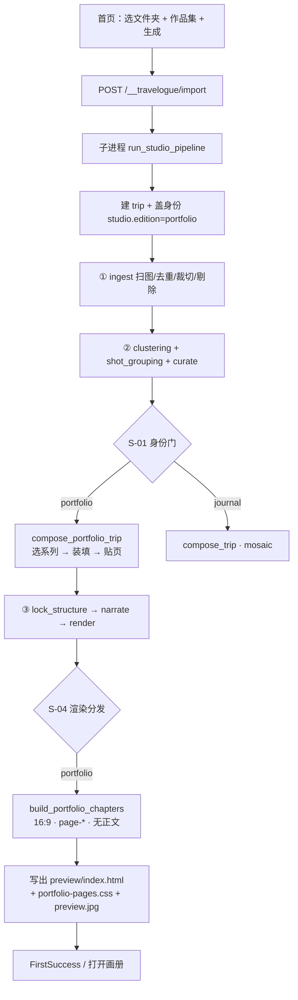

# 作品集模式流程

用户指定文件夹、点击生成，到结果输出的实际路径。作品集和游记共用同一条「导入 → 出册」壳，**真正分叉只有两处**：编排时走 `compose_portfolio_trip`，渲染时走 `build_portfolio_chapters`。其余（扫图、去重、聚类、封面、Studio 壳）是共享的。

所有权仍看 [dual-pipeline-ownership.md](./dual-pipeline-ownership.md)。主链合同见 [readable-core-line.md](./readable-core-line.md)。

> **目标主路径（PFO W1+W2 已落地）** 以 [PRD-PORTFOLIO-FLOW-OPTIMIZATION-V1.md](./PRD-PORTFOLIO-FLOW-OPTIMIZATION-V1.md) **v0.2.1 §4** 为准。线框 F9–F11 **已签**（[记录](./acceptance-records/pfo-f9-f11-signoff-2026-08-25.md)）。W3 真夹狗粮未开。

---

## 用户侧（首页 · PFO W2）

1. 点「作品集」入口，或在导入向导里切到作品集。  
   前端会把 `edition=portfolio` 带上；开关关着会直接 409「此功能已关闭」。
2. 选文件夹（或上传）。向导会先拉相册预览（张数、缩略图、日期）。
3. **规格第一眼**：人话一句（`文件夹 N 张，做成大约一本 X 页。`）+ 默认「自动」+ 开始。  
   「换一本更厚 / 更薄」展开后才出芯片；点具体档才带 `pageCountSource=user`。游记不出现此区。
4. 可选填标题 / 地点 / 日期 / 笔记、精选夹、留片策略。
5. 点生成 → `POST /__travelogue/import`，带上文件夹路径、`edition=portfolio`，以及 `pageCount` / `pageCountSource`。
6. 前端轮询 job，等进度（识图准备 → 处理照片 → 编排 → 文案 → 预览就绪）。
7. 完成后进 FirstSuccess：**打开这一本 ∥ 导出作品集**并列；「去精修封面和成册类型」为弱链。作品集不走倒计时、不走 `autoExport=wechat_chat`。导出进预览同一套 Dock 面板。

---

## 后端总编排

Studio 把一次生成拆成 **三段 `run_trip`**，中间落盘：

对应代码：`templates/studio/homepage-v2/import-run.js` → `travelogue/web/studio_handlers/import_handlers.py` → `studio_subprocess.py` → `run_studio_pipeline`。

---

## 逐步：点生成之后发生了什么

### 0. 建册并盖身份（还没读像素）

`run_studio_pipeline` 会：

- 校验文件夹可导入、张数下限、RAW 拦截
- 可选预热 CLIP（进度条「识图准备」）
- `create_trip` 写出空的 `trip.json`
- 写入标题、地点、笔记、留片偏好
- **`apply_import_edition`**：只在作品集时写 `studio.edition = "portfolio"`，并默认 `studio.portfolio.pageCountSource = "auto"`。游记不写这个字段。

身份一旦盖上，后面两扇门都认它。

### 1. Ingest（共享）— 文件夹变成 `trip.assets[]`

`run_trip(..., from_stage="ingest", until="ingest")` → `ingest_into_trip`：

| 子步骤 | 做什么 |
|--------|--------|
| 扫描 | 递归找图；可分精选夹 / 素材夹 |
| 拷贝 | 进 `trips/<slug>/source/` |
| 去重 | MD5 必做；连拍 / pHash 可由「保留近似重复」关掉 |
| 元数据 | EXIF、朝向、时间、可选地理 |
| 衍生图 | 裁切 / 预览宽度（可后台延后） |
| 识图 | 并行 embed（开了 vision 时） |
| 剔除 | `apply_photo_cull`：糊、近重复、低质等，标 layout-eligible |

**作品集没有单独的 ingest。** 剔完的「可上版照片」才是后面系列匹配的库存。

### 2. Clustering + 镜头组（共享）— 按时间/场景分堆

第二段 `run_trip(..., from_stage="clustering", until="structure")` 会跑到 `curate` 为止，中间包括：

1. **聚类** `run_clustering_layer`：时间段 / 地点 / 场景 → `curation.segments`
2. **镜头组** `run_shot_grouping_layer`：相近时刻的一组，后面**一页不能跨两组**
3. **策展** `run_curate`（见下一节）

Studio 默认三步都开。

### 3. Curate 前半（共享）— 封面、分桶、章骨架

`run_curate` 顺序固定：

1. 意图提示、记忆锚点、cohort
2. **预检**：封面候选、分辨率、layout-eligible 资产
3. **审美对齐**（开了 aesthetic 时）
4. **分桶** `_stage_resolve_buckets`：按天/段把照片装进章节桶
5. **章骨架** `_stage_build_chapters_compose`：空桶丢掉、异常日剥附录、弧线、章英雄、章标题，再 `build_chapters_from_buckets`

到这里作品集和游记还在同一条路上。差别从下一行开始。

### 4. S-01 分叉 — 作品集独占装配

入口在 `travelogue/curation/curate.py`：`is_portfolio_trip(trip)` 为真时调用 `compose_portfolio_trip`。开关关闭则 `E_PORTFOLIO_UNAVAILABLE`。

游记这里会进 `compose_trip`（mosaic 搜索）。作品集**禁止静默掉回游记**：目录空、一张都装不上，直接硬失败。

`compose_portfolio_trip` 内部是四步：

#### ① 装填成组（`fill.py` / `match.groups_from_assets`）

- 相邻间隔中位数 > 60 分钟 → 判「稀疏集」，不再强行并组
- 否则在镜头组基础上，把相邻独照按时间/段落护栏并起来

#### ② 选系列（`match.select_series`）

官方目录在 `travelogue/layout_engine/editorial_series/series/`，现网大约是：

`magazine-8 / 12 / 16 / 20 / 28-standard`

每套有页数、容量、`sequence[]`（每页的 `patternId` + 槽带宽）。  
按「留下的张数 + 用户是否钉页数 + 上限 48 页」选一套。用户钉了非标准页数会靠档（8/12/16…）。

#### ③ 入槽（`place.py` + `slot_match.py`）

- 按系列 `sequence` 一页页取片
- 按横竖比挑具体 `page-*` 面（例如宽横英雄用 `page-1-hero-land-wide`）
- **一页不跨两个镜头组**
- 多章时按照片量把页序切给各章，避免第一章吃光后面只剩游记式 leftovers
- 装不满：自动模式可换更饱满的页数；用户钉页则给「有 N 页没排满」提示
- 装不下的进 `studio.portfolio.overflow`

#### ④ 写回

- `attach_screens_to_chapters`：每页变成 `chapters[].screens[]`（`patternId` + `slots`，舞台 16:9）
- 空章清掉 journal 残留的 `items`
- 戳 `studio.portfolio`：`seriesId`、`pageCount`、`photosPlaced` / `photosKept`、overflow、饱满度

然后 `_stage_finalize`：封面解释、预警、弧线标签、高光。作品集在高光里**早退**（S-03）：只记签名图，不插游记那种高光独屏。

### 5. 锁结构 → 文案 → 渲染

编排结束后，`_studio_post_curate`：

- **精修 + 要确认结构（G1）**：先出一版草稿预览就返回，等你确认后再续跑
- **默认快速分享**：直接第三段  
  `run_trip(..., from_stage="lock_structure", until="rendered")`

| 阶段 | 做什么 | 作品集差异 |
|------|--------|------------|
| `lock_structure` | 锁章节结构；可后台做衍生图 | 无 |
| `narrate` | 写 hook / 章导语 / 跋 | 后面渲染会被剥掉，读者面基本看不见 |
| `lock_copy` | 锁文案 | 无 |
| `render` | `render_trip_surfaces`（`exportLayout=auto`） | 见下一节 |
| `export` | **这次生成不跑** | 之后在书架/工具条里再导出 |

LLM 鉴权失败会降级 stub，避免卡死。然后补一张书架用的 `preview.jpg`。

### 6. S-04 渲染分发 — 纸面怎么长出来

`assemble.build_render_context` 是**唯一**渲染身份门：

- 作品集：清空 hook / 跋
- 调用 `build_portfolio_chapters`（不是 `build_journal_chapters`）

作品集章 builder 会：

- 跳过没有 `screens` 的空章
- 给每页做色调、横图行/四混槽的 fit
- `build_layout_screen(..., stage_aspect="16:9", strip_narrative_copy=True)`
- 不挂游记的 trip-index / 高光廊 / 长图条

`render_trip` 再：

- 用封面引擎出开章（书法题、对页等，封面是共享的）
- 写 `preview/index.html`（以及 web 面）
- **拷贝 `portfolio-pages.css`**，并改复制后的 `journal.css` 里的 `@import`（S-11）。游记拷的是 `journal-screens.css`。
- HTML 上戳 `data-edition="portfolio"`，工具条走 `portfolioDockLogic`

---

## 你最终拿到什么

| 产物 | 位置 / 含义 |
|------|-------------|
| 画册数据 | `trips/<slug>/trip.json`（章、屏、槽、`studio.portfolio`） |
| 读者面 | `trips/<slug>/preview/index.html` + `portfolio-pages.css` |
| 封面卡 | `preview.jpg`（FirstSuccess / 书架） |
| 进度结果 | job 完成 → 前端 `previewUrl`，打开就是 16:9 杂志页 |

页上每张图对应一个 `page-*` 模板（如 `page-1-hero-land-wide`、`page-4-grid-land`），CSS 按 `patternId` 铺网格。

---

## 和游记对照（只记分叉）

| | 游记 | 作品集 |
|--|------|--------|
| 身份 | 不写 / `journal` | `studio.edition=portfolio` |
| 装配 | mosaic 搜索 `screen-*` | 官方系列 `page-*` 顺序装填 |
| 纸面 | 多为竖屏叙事 | 固定 16:9 杂志页 |
| 正文 | hook、章导语、跋 | 渲染层剥掉 |
| CSS | `journal-screens.css` | `portfolio-pages.css` |
| 失败 | 可降级 | **硬失败**，不静默变游记 |
| 多出来的片 | 继续编进屏 | `overflow`，提示「装不下」 |

---

## 一条时间线（快速分享、顺利跑完）

1. 选文件夹，选作品集，点生成
2. 建 `trip.json`，盖 `edition=portfolio`
3. 扫图 → 去重 → 剔除 → embed
4. 聚类分段 → 镜头组
5. 选封面、按天分章
6. **按张数选 magazine-N 系列，按 `sequence` 入槽**
7. 锁结构，写文案（读者面基本不用）
8. 拼 16:9 页 + 封面，写出 HTML/CSS
9. 首页 FirstSuccess，点开就是册子

---

## 关键入口

| 层 | 路径 |
|----|------|
| 首页导入 | `templates/studio/homepage-v2/import-run.js` · `import-wizard.js` |
| HTTP | `travelogue/web/studio_handlers/import_handlers.py` |
| 子进程 | `travelogue/web/studio_subprocess.py` |
| Studio 编排 | `travelogue/web/studio_pipeline.py` · `run_studio_pipeline` |
| 阶段链 | `travelogue/orchestrator/run.py` · `run_trip` |
| 身份 | `travelogue/config/edition.py` · `apply_import_edition` |
| 策展 / S-01 | `travelogue/curation/curate.py` · `_stage_build_chapters_compose` |
| 作品集装配 | `travelogue/layout_engine/editorial_series/compose.py` |
| 系列目录 | `travelogue/layout_engine/editorial_series/series/` |
| 渲染 / S-04 | `travelogue/render/assemble.py` · `build_portfolio_chapters` |
| 读者面 CSS | `templates/visual-journal/portfolio-pages.css` |
